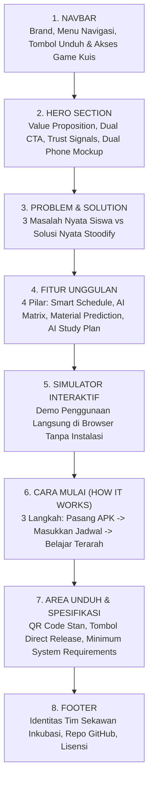

# 📘 Panduan Desain & Spesifikasi Web Promosi: Stoodify
> **Dokumen Resmi Arsitektur Visual, UI/UX, Copywriting, dan Alur Halaman Promosi**  
> **Proyek**: Stoodify Mobile Application (`https://github.com/Sekawan-Inkubasi/stoodify-apk.git`)  
> **Target Audiens Web**: Siswa SMA/SMK sederajat, Pengajar/Mentor, dan Pengunjung Stan Pameran Edukasi  
> **Tujuan**: Mendorong adopsi aplikasi, mengonversi pengunjung menjadi pengguna aktif (unduh APK ~19 MB), serta menyediakan demo interaktif yang dapat dicoba seketika di peramban.

---

## 1. Ringkasan Eksekutif & Identitas Produk

### A. Visi Produk
**Stoodify** adalah aplikasi asisten belajar cerdas berbasis AI yang dirancang khusus untuk siswa sekolah menengah (SMA/SMK). Aplikasi ini mengatasi tiga kendala utama belajar siswa:
1. Jadwal pelajaran yang tercecer dan sulit dipantau.
2. Penumpukan tugas akibat ketidakmampuan memilah prioritas tenggat.
3. Kebingungan materi pelajaran esok hari (*blind learning* tanpa persiapan).

### B. Peran Web Promosi
Web promosi (*landing page*) Stoodify berfungsi sebagai:
- **Etalase Digital Resmi**: Menampilkan proposisi nilai aplikasi dengan bukti nyata antarmuka (*Show, Don't Tell*).
- **Pintu Konversi Utama**: Memfasilitasi unduhan APK Android langsung (*Direct APK Download*) dan pemindaian QR Code instan saat pameran berlangsung.
- **Simulator Interaktif**: Memungkinkan calon pengguna mencoba navigasi dan alur kerja aplikasi Stoodify langsung di layar komputer atau laptop stan tanpa perlu instalasi terlebih dahulu.

---

## 2. Prinsip Desain & Standar Anti-Slop

Desain web promosi Stoodify wajib mengikuti standar desain yang lugas, manusiawi, dan terbebas dari estetika generik AI (*anti-slop*):

| Aspek | ❌ Praktik Slop AI yang DILARANG |  Standar Humanis Stoodify |
| :--- | :--- | :--- |
| **Palet & Gradien** | Gradien ungu-biru neon gelap acak di semua tempat, efek *glassmorphism* buram berlebihan. | Latar belakang kanvas biru pucat bersih (`#F8FBFE`), permukaan kartu putih solid, aksen biru terang fungsional (`#0062FF`). |
| **Klaim & Bukti** | *"Platform AI revolusioner pengubah masa depan pendidikan dunia yang dipercaya jutaan siswa"*. | Informasi faktual konkret: *"APK Android mandiri ~19 MB, -first jalan seketika tanpa kuota, sinkronisasi jadwal otomatis"*. |
| **Kosakata Teks** | *Unlock, elevate, empower, delve, seamlessly, game-changer, robust, journey*. | Kalimat aktif, lugas, santun, dan langsung menjawab kebutuhan siswa sehari-hari. |
| **Hierarki Visual** | Kartu melayang-layang dengan bayangan pekat tanpa batas tepi yang jelas. | Garis tepi samar terstruktur (`border-slate-200/80`), radius konsisten, bayangan halus bervolume rendah. |
| **Aksesibilitas** | Teks abu-abu terang di atas latar putih (kontras rendah). | Rasio kontras teks utama minimal 12:1 (`#0F172A`), tombol aksi minimal 4.8:1 terhadap warna latar. |

---

## 3. Sistem Desain (Design System Tokens)

### A. Palet Warna (Color System)
Semua komponen antarmuka menggunakan palet warna terstandar yang selaras dengan aplikasi mobile Stoodify:

```
[ Primary Brand ]
#0062FF — Stoodify Vibrant Blue (Tombol utama, tab aktif, fokus, brandmark)
#0052D9 — Primary Hover (Interaksi kursor pada tombol)
#003EB3 — Primary Active / Pressed

[ Canvas & Surface ]
#F8FBFE — Background Halaman Utama (Nuansa biru-putih lembut dan bersih)
#FFFFFF — Surface Kartu / Modal / Navigasi
#F1F5F9 — Surface Sekunder / Latar Chip Non-aktif (Slate 100)
#E2E8F0 — Garis Pembatas / Border Elemen (Slate 200)

[ Tipografi & Teks ]
#0F172A — Text Primary / Heading (Slate 900, kontras > 12:1)
#475569 — Text Secondary / Body (Slate 600, kontras > 5.5:1)
#94A3B8 — Text Muted / Caption (Slate 400)

[ Status & Badge Semantik ]
#059669 — Success / Selesai (Emerald 600)
#D97706 — Warning / Tenggat Mendekat (Amber 600)
#E11D48 — Danger / Tugas Mendesak (Rose 600)
#4F46E5 — AI Accent / Sesi Belajar (Indigo 600)
```

### B. Tipografi (Typography)
- **Keluarga Font Utama**: `Poppins`, dengan fallback `system-ui, -apple-system, BlinkMacSystemFont, "Segoe UI", Roboto, sans-serif`.
- **Hierarki Skala Tipografi**:

| Level Tipografi | Ukuran Desktop | Ukuran Mobile | Bobot (Weight) | Jarak Baris (Line Height) |
| :--- | :--- | :--- | :--- | :--- |
| **Hero Title (H1)** | `56px` (`3.5rem`) | `32px` (`2.0rem`) | `800` (Extrabold) | `1.15` (Rapat) |
| **Section Title (H2)**| `36px` (`2.25rem`)| `24px` (`1.5rem`)  | `700` (Bold)      | `1.25` |
| **Card Title (H3)**   | `20px` (`1.25rem`)| `18px` (`1.125rem`)| `600` (Semibold)  | `1.35` |
| **Lead Subheading**   | `18px` (`1.125rem`)| `15px` (`0.95rem`) | `400` (Regular)   | `1.6` |
| **Body Paragraph**    | `15px` (`0.95rem`) | `14px` (`0.875rem`)| `400` (Regular)   | `1.55` |
| **Button / Nav Label**| `14px` / `15px`   | `14px`             | `600` (Semibold)  | `1.0` |
| **Micro Caption/Badge**| `12px` (`0.75rem`)| `11px`             | `600` (Semibold)  | `1.0` |

### C. Geometri, Elevasi & Tata Letak
- **Batas Lebar Konten**: Kontainer utama dibatasi maksimal `1152px` (`max-w-6xl`) dengan margin tengah otomatis dan bantalan sisi `px-4 sm:px-6 lg:px-8`.
- **Radius Sudut (Border Radius)**:
  - Tombol & Chip: `rounded-xl` (`12px`) hingga `rounded-full` (`9999px`).
  - Kartu Fitur & Simulasi: `rounded-2xl` (`16px`) hingga `rounded-3xl` (`24px`).
  - Bezel Mockup Smartphone: `rounded-[44px]` (Rasio radius ponsel modern).
- **Sistem Elevasi (Shadows)**:
  - `shadow-btn-primary`: `0 8px 20px -4px rgba(0, 98, 255, 0.35)` (Glow biru lembut pada tombol utama).
  - `shadow-card`: `0 4px 18px -2px rgba(15, 23, 42, 0.05)` (Bayangan kartu dasar).
  - `shadow-phone`: `0 24px 48px -12px rgba(15, 23, 42, 0.18)` (Efek kedalaman mockup ponsel).

---

## 4. Struktur Anatomi Halaman Web Promosi

Web promosi disusun dalam 8 bagian (*sections*) linier yang mengalir secara berurutan untuk memaksimalkan retensi dan tindakan pengunjung:



---

### Bagian 1: Navbar (Header Navigasi)
- **Tujuan**: Memperkenalkan brand, memberi navigasi cepat antar-bagian, dan menyediakan tombol tindakan cepat.
- **Elemen Antarmuka**:
  - **Sisi Kiri**: Logo resmi Stoodify (ikon buku pintar/studi dengan aksen biru) + tipografi brand *Stoodify* berbobot 800.
  - **Bagian Tengah**: Tautan menu (*Fitur*, *Keunggulan*, *Simulator*, *Cara Pakai*, *Spesifikasi*).
  - **Sisi Kanan**:
    - Tombol Sekunder Beranimasi: *"Mainkan Kuis Pameran"* (Ikon roda putar/gamepad, membuka mode stan interaktif).
    - Tombol Aksi Utama: *"Unduh APK"* (Background `#0062FF`, ikon unduh, tautan langsung ke rilis).
- **Perilaku Responsif**: Pada layar ponsel/tablet, menu tengah dikompresi menjadi tombol drawer samping (*hamburger button*) dengan latar belakang putih bersih dan transisi geser mulus.

---

### Bagian 2: Hero Section (Proposisi Nilai Utama)
- **Tujuan**: Menangkap perhatian pengunjung dalam 3 detik pertama dengan mengatasi rasa cemas siswa terhadap jadwal dan tugas.
- **Komposisi 2-Kolom (Desktop)**:
  - **Kolom Kiri (Pesan & Ajakan Tindakan)**:
    - *Badge Status Ringkas*: `"✨ Asisten Belajar Pintar Berbasis AI"`.
    - *Headline Utama*:  
      > **Belajar Efektif Tanpa Panik Bareng Stoodify.**
    - *Sub-headline*:  
      > Asisten belajar pintar berbasis AI yang menyusun jadwal sekolah terintegrasi, memprioritaskan tugas mendesak, dan memprediksi materi yang akan datang: semuanya dalam satu genggaman.
    - *Grup Tombol CTA*:
      1. **Tombol Primer**: `"Coba Simulator Langsung"` (Membawa layar langsung bergulir ke Bagian 5).
      2. **Tombol Sekunder**: `"Unduh APK Android (~19 MB)"` (Tautan ke file installer rilis resmi).
    - *Trust Signals (Micro-Highlight)*:
      - ⚡ **-First**: Jalan seketika tanpa kuota, 0 detik loading.
      - 📦 **Ringan & Hemat Memori**: Ukuran berkas APK hanya ~19 MB.
      - 🛡️ **Bebas Iklan & Pelacak**: Fokus murni untuk kenyamanan belajar.
  - **Kolom Kanan (Visual Dual-Phone Mockup)**:
    - Menampilkan dua ponsel Android bersisian dalam sudut pandang prespektif yang rapi.
    - **Ponsel Depan**: Menampilkan *HomeView* Stoodify (Kartu jadwal pelajaran hari ini, sapaan personal siswa, streak belajar harian, dan ringkasan tugas aktif).
    - **Ponsel Belakang**: Menampilkan *TasksView* atau *AIPlanView* (Matriks prioritas tugas dengan kartu berkode warna darurat, sedang, santai).

---

### Bagian 3: Masalah Nyata vs Solusi Stoodify
- **Tujuan**: Membangun empati emosional dengan menggambarkan situasi belajar siswa saat ini yang kacau, lalu menyajikan solusinya secara presisi.
- **Format Tampilan**: 3 pasang kartu komparasi (*Problem vs Stoodify Solution*):

| No | Masalah Siswa (Sebelum) | Solusi Stoodify (Sesudah) |
| :--- | :--- | :--- |
| **1** | **Jadwal Pelajaran Tercecer**<br/>Catatan di buku sering hilang, lupa ruangan kelas, dan bingung guru yang mengajar di jam tertentu. | **Smart Schedule Synchronization**<br/>Jadwal mingguan tersimpan rapi di HP, otomatis menandai jam masuk dan mata pelajaran aktif saat itu juga. |
| **2** | **Kepanikan Deadline Mendadak**<br/>Mengerjakan tugas sistem kebut semalam karena tidak tahu tugas mana yang harus diselesaikan terlebih dahulu. | **AI Task Priority Matrix**<br/>Algoritma cerdas memilah tugas menjadi 4 level urgensi secara otomatis berdasarkan bobot dan sisa waktu pengumpulan. |
| **3** | **Bingung Materi Pelajaran Besok**<br/>Datang ke kelas tanpa persiapan, merasa tertinggal materi saat guru menjelaskan materi baru di papan tulis. | **AI Material Prediction**<br/>AI memprediksi bab dan materi berikutnya sesuai kurikulum, memberi ringkasan poin inti untuk dibaca 5 menit sebelum kelas. |

---

### Bagian 4: Fitur Unggulan Aplikasi (Core Features)
- **Tujuan**: Menjelaskan 4 pilar fungsional utama aplikasi mobile secara mendalam dengan visual ikonografi yang jelas.
- **Grid Tampilan**: 4 Kartu Fitur Besar (Grid 2x2 pada Desktop, 1 Kolom pada Mobile):

1. **Jadwal Harian Terintegrasi (Smart School Timetable)**
   - Menyimpan seluruh jam pelajaran sekolah dari Senin sampai Jumat/Sabtu.
   - Dilengkapi indikator waktu nyata (*current ongoing class indicator*).
   - Memuat detail ruang kelas, nama guru pengampu, serta catatan khusus pertemuan.

2. **Manajemen Prioritas Tugas AI (Automated Priority Matrix)**
   - Pengelompokan tugas otomatis berdasarkan tenggat: *Mendesak (Merah)*, *Segera (Kuning)*, dan *Santai (Hijau)*.
   - Peringatan visual jelas agar siswa tidak lagi terlewat waktu pengumpulan.
   - Filter tugas cepat: Semua, Aktif, Selesai, dan per Mata Pelajaran.

3. **Prediksi Materi Belajar (AI Material Prediction Engine)**
   - Fitur unggulan pertama di kelasnya: Mengintegrasikan jadwal besok dengan silabus pelajaran.
   - Menyediakan rangkuman poin-poin krusial yang kemungkinan besar akan diterangkan guru.
   - Menyiapkan siswa untuk bertanya lebih aktif dan percaya diri di kelas.

4. **Sesi Belajar Terjadwal & Pomodoro (AI Study Session & Focus Timer)**
   - Membantu siswa menyisihkan blok waktu khusus 25-45 menit untuk mencicil materi.
   - Dilengkapi *Focus Timer* tanpa notifikasi media sosial untuk melatih konsentrasi mendalam.
   - Pelacakan akumulasi jam belajar harian dan pencapaian streak belajar berturut-turut.

---

### Bagian 5: Simulator Interaktif (Interactive In-Browser Showcase)
- **Tujuan**: Mengizinkan pengunjung berinteraksi langsung dengan antarmuka Stoodify tanpa harus membuka smartphone. Sangat krusial untuk layar stan pameran atau pengguna desktop yang ingin melihat isi aplikasi.
- **Spesifikasi Komponen Simulator**:
  - **Bezel Ponsel Fisik**: Didesain menyerupai bingkai flagship Android dengan punch-hole kamera depan di bagian atas tengah.
  - **Dukungan Layar Pilihan**:
    - *Tab 1: Beranda* — Menampilkan jadwal pelajaran, ringkasan jam masuk, dan streak belajar.
    - *Tab 2: Tugas* — Menampilkan daftar tugas dengan badge prioritas yang bisa diklik.
    - *Tab 3: Prediksi Materi* — Menampilkan modal interaktif materi yang diprediksi AI untuk pelajaran kimia/matematika/bahasa.
    - *Tab 4: Sesi Belajar* — Menampilkan ringkasan rencana belajar AI harian.
  - **Kemampuan Klik Nyata**: Pengunjung dapat menekan tab bawah untuk berpindah layar, membuka modal detail, dan menutupnya kembali secara langsung.

---

### Bagian 6: Alur Penggunaan (How It Works)
- **Tujuan**: Menghilangkan hambatan psikologis teknis dengan membuktikan bahwa memulai dengan Stoodify sangat mudah dalam 3 langkah singkat:
  1. **Langkah 1 — Unduh & Pasang Ringkas (1 Menit)**: Unduh installer APK resmi (~19 MB), pasang di HP Android tanpa perlu registrasi rumit yang menyita waktu.
  2. **Langkah 2 — Masukkan Jadwal & Tugas Sekolah (2 Menit)**: Input mata pelajaran dan deadline tugas yang sedang dihadapi minggu ini.
  3. **Langkah 3 — Dapatkan Arahan Belajar Otomatis**: AI Stoodify langsung memetakan kapan kamu harus belajar, tugas mana yang harus diselesaikan sekarang, dan apa yang harus dipelajari untuk besok.

---

### Bagian 7: Area Unduh & Spesifikasi Teknis (Download & Exhibition Ready)
- **Tujuan**: Mengonversi pengunjung menjadi pengunduh berkas APK di tempat.
- **Komponen**:
  - **Sisi Kiri: Kartu Unduh Digital**:
    - Tombol unduh berukuran besar: `"Unduh Stoodify APK v1.0.0 (Release)"`.
    - Informasi berkas: Ukuran `~19 MB`, Target Arsitektur `arm64-v8a / universal`, Versi Android minimum `Android 8.0 (Oreo) ke atas`.
    - Tautan ke riwayat rilis GitHub: `https://github.com/Sekawan-Inkubasi/stoodify-apk/releases`.
  - **Sisi Kanan: Kartu QR Code Pemindaian Cepat**:
    - Komponen QR Code interaktif beresolusi tajam menggunakan `qrcode.react`.
    - Label panduan: *"Arahkan kamera smartphone kamu ke QR Code ini untuk mengunduh APK langsung ke ponsel."*
    - Sangat optimal saat web ini dibuka di layar monitor besar stan pameran sekolah / universitas.

---

### Bagian 8: Footer & Informasi Pengembang
- **Tujuan**: Kredibilitas, legalitas, hak cipta, dan transparansi tim pembuat.
- **Konten**:
  - Logo Stoodify + Pernyataan: *"Dibuat dengan dedikasi oleh Tim Sekawan Inkubasi untuk mendukung pembelajaran siswa Indonesia."*
  - Tautan Repositori GitHub:
    - Aplikasi Android: `https://github.com/Sekawan-Inkubasi/stoodify-apk`
    - Frontend Web: `https://github.com/Sekawan-Inkubasi/stoodify-mobile`
    - Backend API: `https://github.com/Sekawan-Inkubasi/stoodify-backend`
  - Hak Cipta & Lisensi: © 2026 Sekawan Inkubasi. Open Source under MIT License.

---

## 5. Panduan Copywriting & Nada Bicara (Tone of Voice)

### A. Karakter Suara Brand (Brand Voice)
- **Bersahabat & Mengerti Beban Siswa**: Nada bicara seperti teman belajar sebaya yang pintar, suportif, dan menenangkan, bukan seperti instruktur militer atau bot korporat yang kaku.
- **Rasional & Berorientasi Solusi**: Menjelaskan manfaat nyata fungsi aplikasi, bukan menjual mimpi abstrak.

### B. Daftar Istilah & Blacklist Kosakata

| Jangan Gunakan (Blacklist AI Slop) | Gunakan Sebagai Gantinya (Human Stoodify) | Alasan |
| :--- | :--- | :--- |
| *Revolusi cara belajarmu sekarang* | *Belajar lebih tenang tanpa panik tugas* | Menghindari hiperbola berlebihan. |
| *Membuka potensi tanpa batas* | *Bantu atur waktu sekolah dan tugasmu* | Langsung menjelaskan kegunaan konkret. |
| *Platform terdepan yang didukung teknologi masa depan* | *Asisten belajar pintar berbasis AI* | Spesifik, lugas, dan akurat. |
| *Fitur canggih yang seamless dan robust* | *Ringan, hemat memori, dan jalan * | Fakta teknis yang dicari oleh siswa. |
| *Tingkatkan perjalanan belajarmu* | *Mulai cicil tugas dan siapkan materi besok* | Aksi nyata yang bisa dikerjakan detik ini. |

---

## 6. Spesifikasi Teknis Implementasi Frontend

Untuk membangun atau memelihara web promosi ini dengan performa tertinggi, gunakan tumpukan teknologi (*tech stack*) berikut:

| Komponen | Pilihan Teknologi | Alasan Pemilihan |
| :--- | :--- | :--- |
| **Framework** | **React 19** + **Vite** | Waktu kompilasi secepat kilat (*sub-second HMR*), bundle size minimal, kompatibel dengan React 19 native. |
| **Bahasa** | **TypeScript** (`~5.8` / `6.0`) | Type safety absolut, mencegah runtime crash pada interaksi simulator. |
| **Styling** | **Tailwind CSS v4** | Performa compile instan tanpa file postcss berbelit, konfigurasi variabel CSS native. |
| **Ikonografi** | **Lucide React** (`lucide-react`) | Desain ikon minimalis, stroke 1.75 - 2px yang seragam dengan UI mobile. |
| **QR Code Generator** | **qrcode.react** | Render canvas SVG berpresisi tinggi tanpa ketergantungan API pihak ketiga. |
| **Audio SFX (Kuis/Interaksi)** | Web Audio API / Synthesizer Ringan | Efek audio jingle dan clicky retro tanpa file MP3 besar yang memperlambat koneksi. |

---

## 7. Checklist Kesiapan Peluncuran (Launch Checklist)

Sebelum web promosi disebarluaskan atau dipajang di monitor stan pameran:
- [ ] **Lighthouse Performance Score** di atas 95 pada mode Desktop dan Mobile.
- [ ] **Tautan Download APK** mengarah ke URL release GitHub yang benar dan aktif mengunduh file `.apk`.
- [ ] **QR Code Generator** menghasilkan URL tujuan yang benar dan dapat terbaca oleh scanner kamera Android / iOS standar.
- [ ] **Simulator Interaktif** berfungsi dengan baik saat disentuh (*touch screen*) di monitor tablet atau diklik dengan mouse.
- [ ] **Responsive Breakpoints** teruji sempurna pada resolusi ponsel (`360px`, `390px`, `412px`), tablet (`768px`, `820px`), dan desktop (`1280px`, `1920px`).
- [ ] **Kontras Warna Teks** lulus uji kepatuhan WCAG 2.1 Level AA di semua blok informasi penting.
- [ ] **Bebas Error Konsol**: Tidak ada warning atau unhandled exception di DevTools browser.
